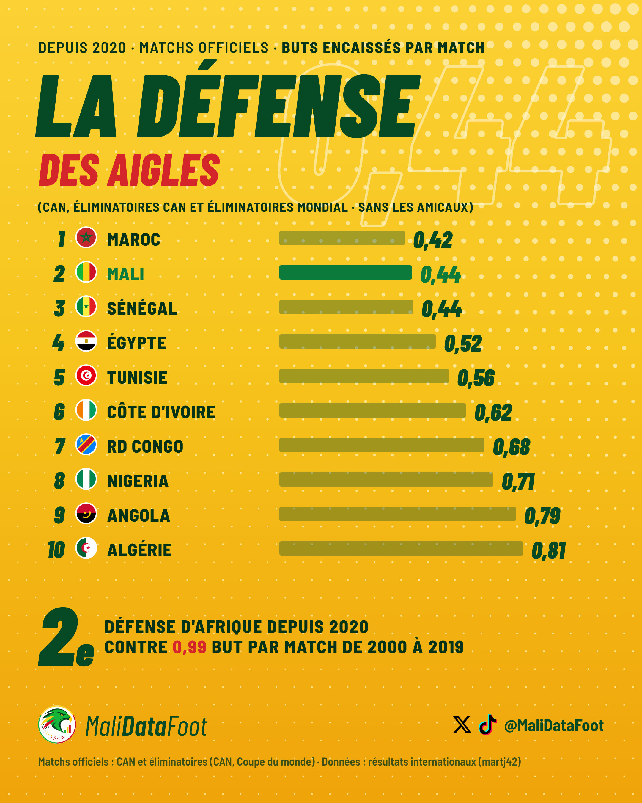
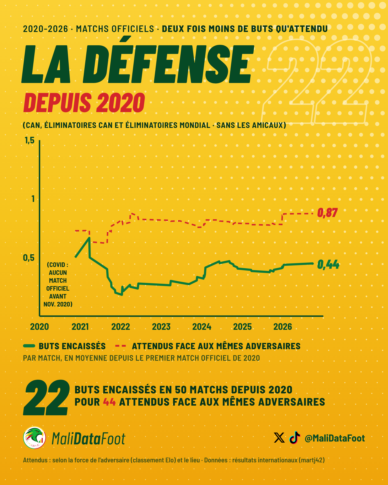
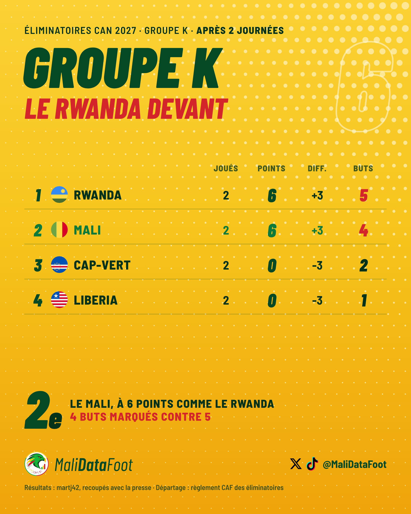
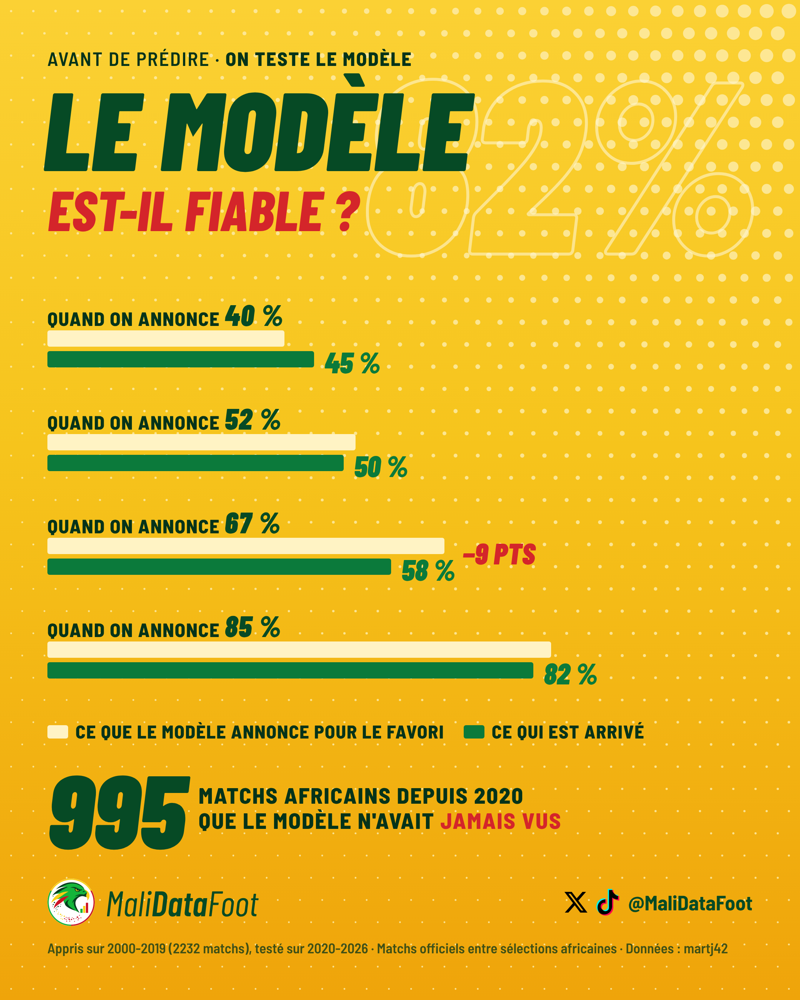
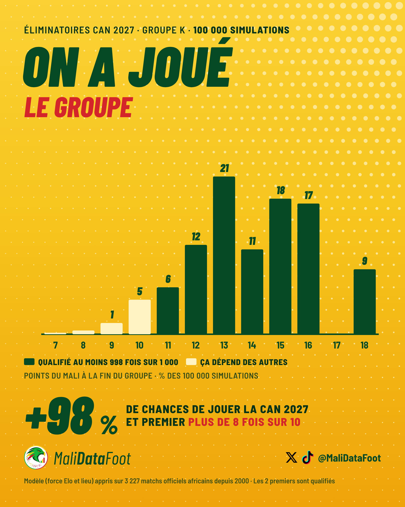
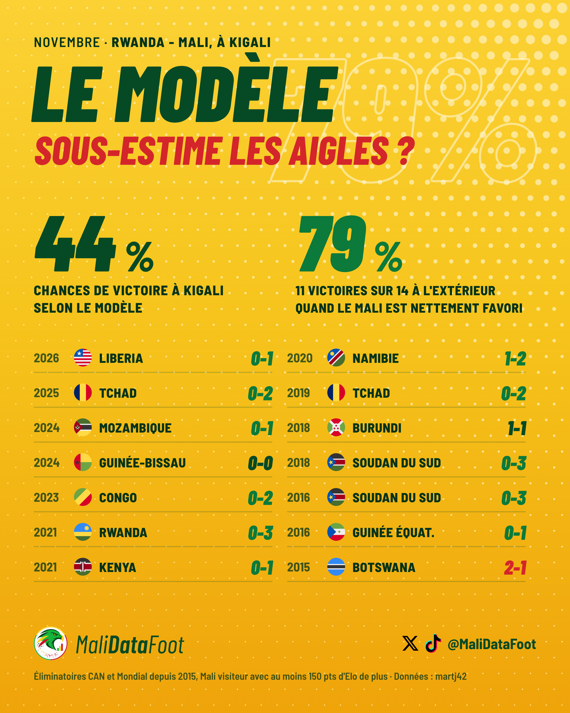
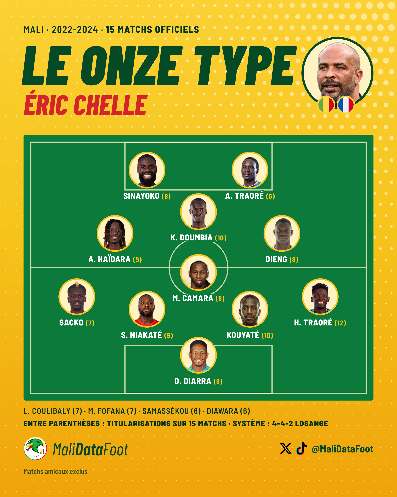
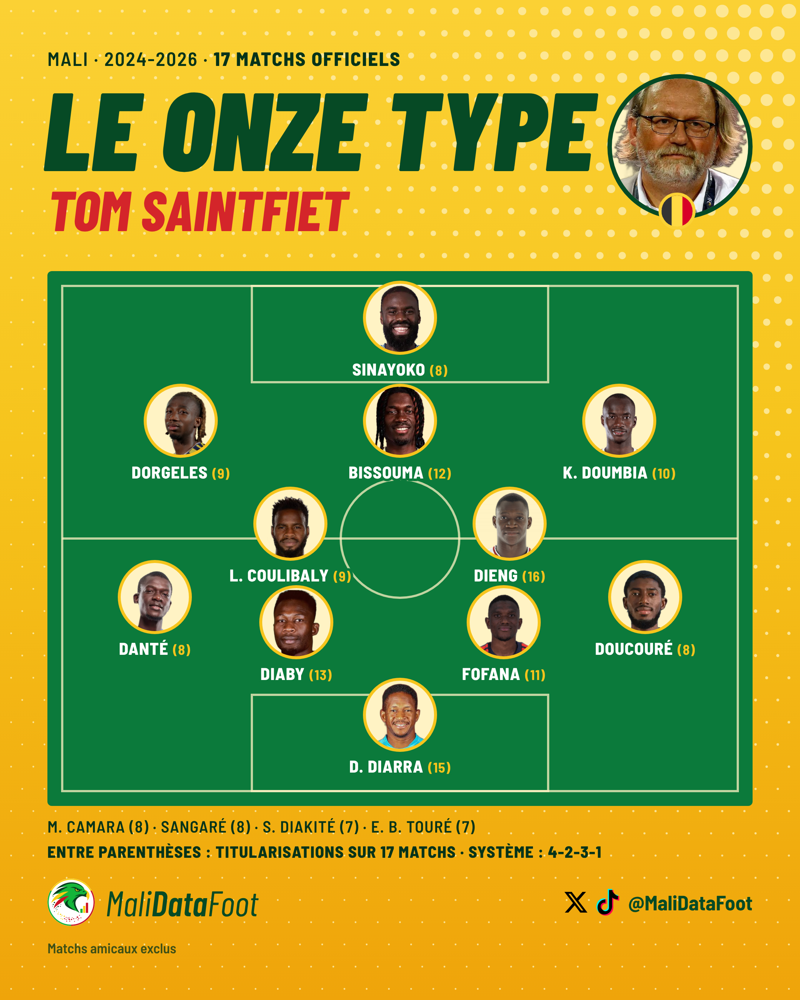

# La DA en images : les visuels validés

La trace de la direction artistique. Chaque post publié ou validé est ici, avec ses images finales (dans `livrables/`, versionnées dans le dépôt), le script qui les fabrique et les choix de forme décidés avec Diaby. Les règles écrites sont dans le skill `malidatafoot-direction-artistique` (section 0) ; ce fichier montre à quoi elles ressemblent pour de vrai.

Avant un nouveau visuel : partir d'un de ces exemples, jamais d'un souvenir.

## Les bases communes (gabarit `visuels/posts_video.py`)

- Fond jaune en dégradé avec la trame de points, titre vert foncé en très gras italique, sous-titre rouge.
- Ligne du haut en petit : contexte · période · **le chiffre clé**.
- Pied : logo rond, Mali*Data*Foot, logos X et TikTok + @MaliDataFoot, puis une ligne de source courte.
- X : 1080 × 1350, rendu HD en 2160 × 2700. TikTok : la même page descendue dans la zone sûre, 1080 × 1920 (rendu 2160 × 3840).
- Rien de sombre au-delà de x = 1020 (marge X), vérifié à chaque rendu.

## Post 1 · La défense des Aigles depuis 2020 (publié le 15/10/2026)

Script : `visuels/posts_video.py` · Fichiers : `livrables/post1-defense/`

## Post 2 · Namibie-Mali aux rayons X (vidéo, prête le 15/10/2026)

Fichiers : `livrables/video-explique/v3e-voix.mp4`, `texte-X.txt`, `description-TikTok.txt`.

## Post 3 · On a joué le groupe 100 000 fois (prêt, sortie avant Mali-Rwanda)

Script : `visuels/posts_p3.py` · Fichiers : `livrables/post3-simulation/`

Choix retenus : vrais drapeaux ronds (circle-flags, `visuels/drapeaux/`), pas d'aspect « carte », peu de texte sur l'image (« −9 PTS » plutôt qu'une phrase), formulations respectueuses des autres pays (« nettement favori »).

## Post 4 · Le onze type de Chelle et de Saintfiet (prêt, publication prévue le 16/10/2026)

Script : `visuels/posts_p4.py` · Fichiers : `livrables/post4-onze-type/`

Choix retenus :
- Terrain vert dessiné en SVG, joueurs en ronds photo (fond crème, bord jaune), nom en blanc avec un contour vert pour rester lisible sur les lignes.
- Le chiffre entre parenthèses, en petit et en jaune, après le nom : « SINAYOKO (8) ». Plus de pastille sur la photo (elle cachait les visages).
- Photo du coach en grand en haut à droite, à la place du chiffre fantôme, avec ses drapeaux en dessous (Chelle : Mali puis France ; Saintfiet : Belgique).
- Têtes à la même taille dans tous les ronds : on compare sur une planche côte à côte avant de valider (ni trop loin, ni trop zoomé).
- Sous le terrain : les 4 suivants (non gras, sans intitulé), puis la légende en gras « ENTRE PARENTHÈSES : TITULARISATIONS SUR N MATCHS · SYSTÈME : … ».
- Pied réduit à « Matchs amicaux exclus » ; le crédit StatsBomb (CAN 2023) passe dans le texte du post.
- Photos : provenance de chacune dans `visuels/photos/SOURCES.md`.
